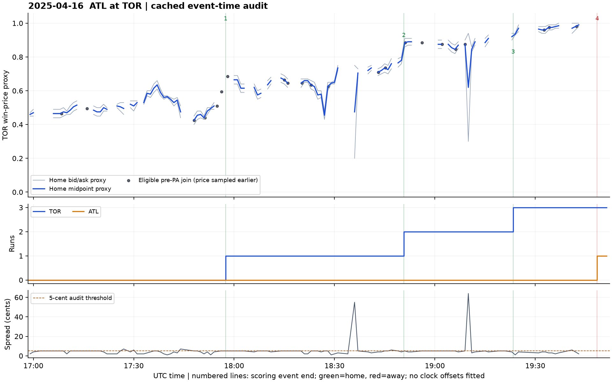
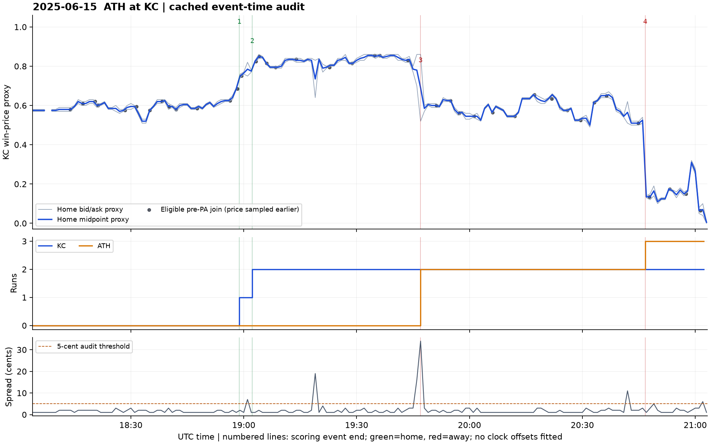
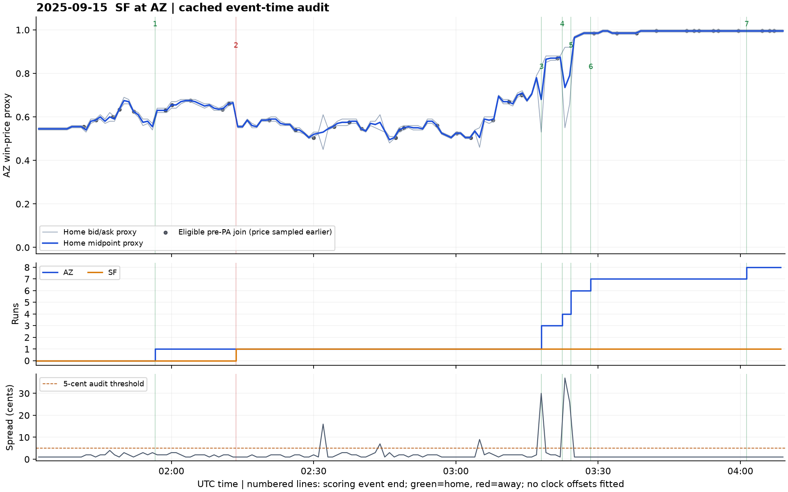
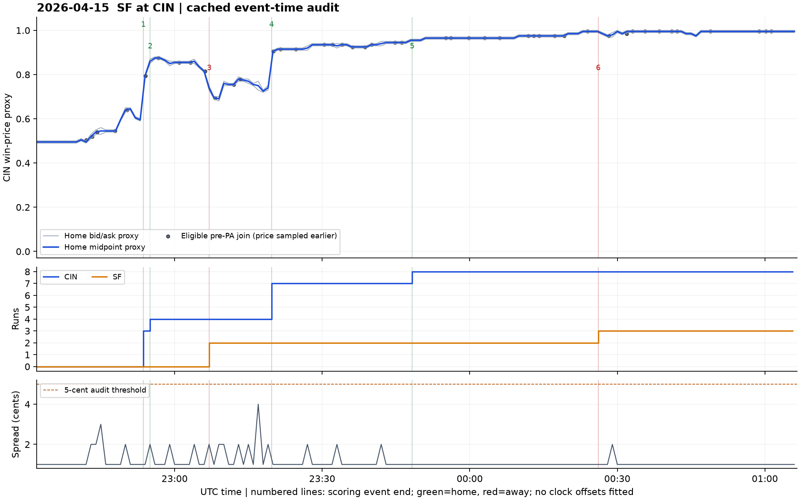
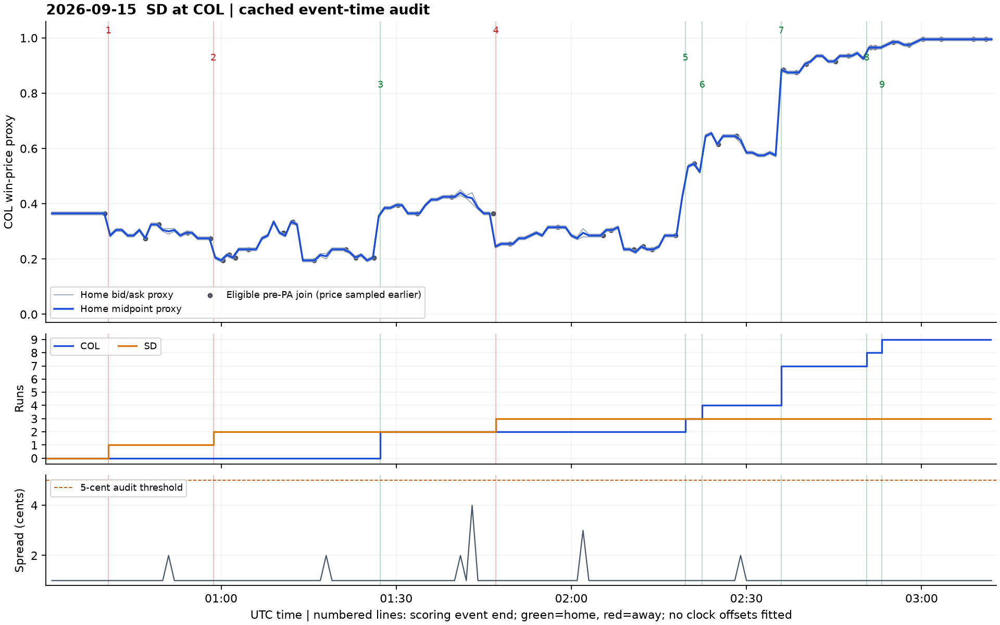
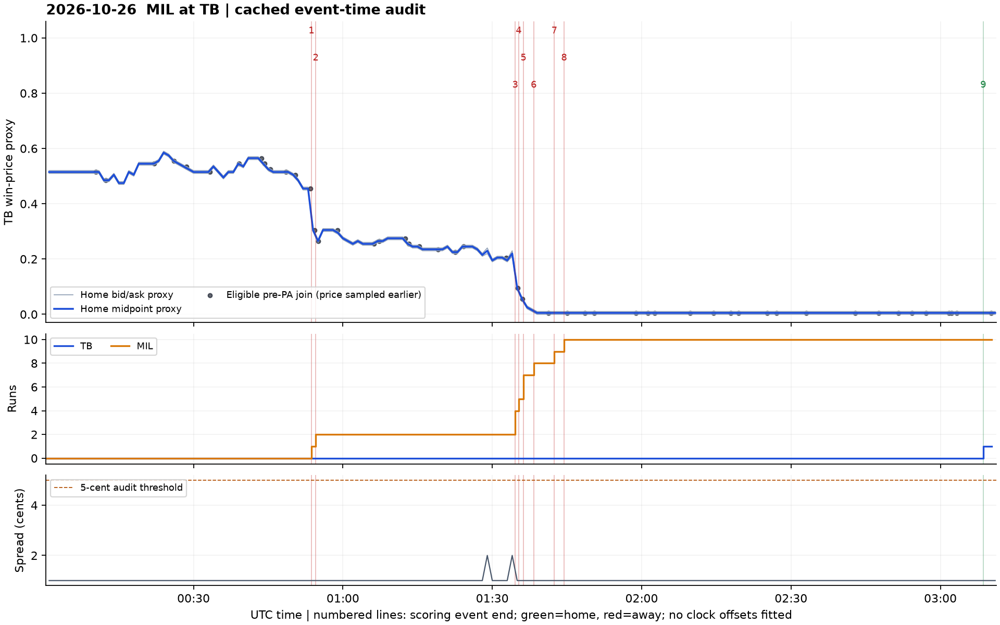

# MLB game-state and market alignment audit

Six complete games reconstructed from the saved October 27, 2026 API snapshot. This validates historical event-time alignment, not real-time feed delivery or latency arbitrage.

## Reconstruction and conservative joins

Runner movements were processed in event-index order. Multiple movements of one runner within an event were collapsed to the final destination. Scores, outs, and occupied bases were checked against MLB after every plate appearance; final scores were checked against linescores.

The decision anchor is the first pitch of each plate appearance (PA). A quote must end strictly before that anchor. An eligible join also requires that the candle endpoint is after the preceding PA finished and after any further recorded state change before the first pitch, with quote age at most 60 seconds and a positive spread no wider than 5 cents. Candle existence alone does not establish quote freshness. This rule is deliberately stricter than a generic backward join.

| Game date | Away at home | PAs checked | Score/base/out mismatches | Backward joins within 60s | Same recorded state within 60s | Eligible at <=5c spread | Scoring episodes |
| --- | --- | ---: | ---: | ---: | ---: | ---: | ---: |
| 2025-04-16 | ATL at TOR | 68 | 0 | 40 | 23 | 22 | 4 |
| 2025-06-15 | ATH at KC | 73 | 0 | 73 | 43 | 41 | 4 |
| 2025-09-15 | SF at AZ | 69 | 0 | 69 | 41 | 39 | 7 |
| 2026-04-15 | SF at CIN | 75 | 0 | 75 | 46 | 46 | 6 |
| 2026-09-15 | SD at COL | 80 | 0 | 80 | 43 | 43 | 9 |
| 2026-10-26 | MIL at TB | 76 | 0 | 76 | 50 | 50 | 9 |

Across all games: **441 plate appearances**, **39 scoring episodes**, and **zero** score/base/out reconstruction mismatches. Timestamp-order warnings, if any, are reported separately in `summary.json`.

### Lag sensitivity

The same backward-join rules were repeated with fixed 30- and 60-second safety lags. The state at the decision time is still required to have existed at the earlier quote endpoint. This tests sample loss under conservative timing, not the optimal latency offset.

| Safety lag | Age-qualified candidates | Same-state candidates | Eligible with spread filter |
| --- | ---: | ---: | ---: |
| 0s | 413 | 246 | 241 |
| 30s | 406 | 125 | 124 |
| 60s | 417 | 122 | 120 |

## Scoring-event inspection

Every run-producing event was identified from reconstructed score changes, including mid-PA runs that MLB's PA-level `isScoringPlay` flag can omit. Each episode has diagnostic windows: the last candle strictly before the event starts, and the first candle ending at least 0, 60, or 120 seconds after the event ends. Intervening state changes and other scoring episodes are counted in the CSV. These windows can combine several pieces of baseball news; they are not causal price-impact estimates or evidence of exploitable market delay.

Home prices use the sampled contract's YES quotes when it is the home team; otherwise `home_bid = 1 - away_ask` and `home_ask = 1 - away_bid`. This is the NO side of that contract, not an independently observed second team's order book.

### 2025-04-16: ATL at TOR



Times below are UTC event-end timestamps. Scores are away-home. Price changes compare the last pre-event candle with the first candle ending at least 60 seconds after event end.

| Episode | UTC end | Inning | Event | Score | Home midpoint before -> after | Quote quality | Other state changes |
| --- | --- | --- | --- | --- | --- | --- | ---: |
| 1 | 17:57:27 | bottom 3 | Single | 0-1 | 0.595 -> 0.665 | wide / stale / missing | 1 |
| 2 | 18:50:43 | bottom 6 | Home Run | 0-2 | 0.780 -> 0.890 | passes | 0 |
| 3 | 19:23:22 | bottom 7 | Double | 0-3 | 0.920 -> 0.970 | passes | 0 |
| 4 | 19:48:30 | top 9 | Home Run | 1-3 | 0.990 -> 0.995 | wide / stale / missing | 2 |
### 2025-06-15: ATH at KC



Times below are UTC event-end timestamps. Scores are away-home. Price changes compare the last pre-event candle with the first candle ending at least 60 seconds after event end.

| Episode | UTC end | Inning | Event | Score | Home midpoint before -> after | Quote quality | Other state changes |
| --- | --- | --- | --- | --- | --- | --- | ---: |
| 1 | 18:58:49 | bottom 3 | Double | 0-1 | 0.685 -> 0.765 | passes | 0 |
| 2 | 19:02:16 | bottom 3 | Single | 0-2 | 0.775 -> 0.850 | passes | 1 |
| 3 | 19:46:58 | top 6 | Home Run | 2-2 | 0.780 -> 0.585 | wide / stale / missing | 0 |
| 4 | 20:46:41 | top 9 | Home Run | 3-2 | 0.525 -> 0.135 | passes | 0 |
### 2025-09-15: SF at AZ



Times below are UTC event-end timestamps. Scores are away-home. Price changes compare the last pre-event candle with the first candle ending at least 60 seconds after event end.

| Episode | UTC end | Inning | Event | Score | Home midpoint before -> after | Quote quality | Other state changes |
| --- | --- | --- | --- | --- | --- | --- | ---: |
| 1 | 01:56:33 | bottom 1 | Pickoff Error 1B | 0-1 | 0.555 -> 0.630 | passes | 1 |
| 2 | 02:13:36 | top 3 | Home Run | 1-1 | 0.665 -> 0.555 | passes | 0 |
| 3 | 03:18:02 | bottom 6 | Single; Runner Out | 1-3 | 0.780 -> 0.870 | passes | 0 |
| 4 | 03:22:25 | bottom 6 | Double | 1-4 | 0.875 -> 0.790 | wide / stale / missing | 0 |
| 5 | 03:24:16 | bottom 6 | Home Run | 1-6 | 0.735 -> 0.975 | wide / stale / missing | 0 |
| 6 | 03:28:26 | bottom 6 | Triple | 1-7 | 0.985 -> 0.985 | passes | 1 |
| 7 | 04:01:20 | bottom 8 | Double | 1-8 | 0.995 -> 0.995 | passes | 1 |
### 2026-04-15: SF at CIN



Times below are UTC event-end timestamps. Scores are away-home. Price changes compare the last pre-event candle with the first candle ending at least 60 seconds after event end.

| Episode | UTC end | Inning | Event | Score | Home midpoint before -> after | Quote quality | Other state changes |
| --- | --- | --- | --- | --- | --- | --- | ---: |
| 1 | 22:53:38 | bottom 1 | Home Run | 0-3 | 0.595 -> 0.860 | passes | 0 |
| 2 | 22:55:01 | bottom 1 | Home Run | 0-4 | 0.795 -> 0.875 | passes | 1 |
| 3 | 23:07:01 | top 2 | Double | 2-4 | 0.815 -> 0.690 | passes | 0 |
| 4 | 23:19:41 | bottom 2 | Home Run | 2-7 | 0.740 -> 0.915 | passes | 1 |
| 5 | 23:48:16 | bottom 4 | Home Run | 2-8 | 0.945 -> 0.955 | passes | 0 |
| 6 | 00:26:06 | top 7 | Single | 3-8 | 0.995 -> 0.975 | passes | 1 |
### 2026-09-15: SD at COL



Times below are UTC event-end timestamps. Scores are away-home. Price changes compare the last pre-event candle with the first candle ending at least 60 seconds after event end.

| Episode | UTC end | Inning | Event | Score | Home midpoint before -> after | Quote quality | Other state changes |
| --- | --- | --- | --- | --- | --- | --- | ---: |
| 1 | 00:40:41 | top 1 | Home Run | 1-0 | 0.365 -> 0.305 | passes | 1 |
| 2 | 00:58:40 | top 2 | Home Run | 2-0 | 0.275 -> 0.195 | passes | 2 |
| 3 | 01:27:17 | bottom 3 | Home Run | 2-2 | 0.205 -> 0.385 | passes | 0 |
| 4 | 01:47:04 | top 5 | Home Run | 3-2 | 0.365 -> 0.255 | passes | 0 |
| 5 | 02:19:31 | bottom 6 | Double | 3-3 | 0.425 -> 0.545 | passes | 0 |
| 6 | 02:22:24 | bottom 6 | Single | 3-4 | 0.515 -> 0.655 | passes | 0 |
| 7 | 02:35:56 | bottom 6 | Home Run | 3-7 | 0.575 -> 0.875 | passes | 1 |
| 8 | 02:50:34 | bottom 7 | Double | 3-8 | 0.925 -> 0.965 | passes | 1 |
| 9 | 02:53:12 | bottom 7 | Single | 3-9 | 0.965 -> 0.985 | passes | 1 |
### 2026-10-26: MIL at TB



Times below are UTC event-end timestamps. Scores are away-home. Price changes compare the last pre-event candle with the first candle ending at least 60 seconds after event end.

| Episode | UTC end | Inning | Event | Score | Home midpoint before -> after | Quote quality | Other state changes |
| --- | --- | --- | --- | --- | --- | --- | ---: |
| 1 | 00:53:40 | top 3 | Single | 1-0 | 0.455 -> 0.265 | passes | 1 |
| 2 | 00:54:31 | top 3 | Single | 2-0 | 0.305 -> 0.305 | passes | 1 |
| 3 | 01:34:35 | top 5 | Single | 4-0 | 0.220 -> 0.055 | passes | 1 |
| 4 | 01:35:17 | top 5 | Single | 5-0 | 0.095 -> 0.025 | passes | 1 |
| 5 | 01:36:14 | top 5 | Double | 7-0 | 0.055 -> 0.015 | passes | 0 |
| 6 | 01:38:18 | top 5 | Double | 8-0 | 0.015 -> 0.005 | passes | 0 |
| 7 | 01:42:26 | top 5 | Single | 9-0 | 0.005 -> 0.005 | passes | 0 |
| 8 | 01:44:24 | top 5 | Double | 10-0 | 0.005 -> 0.005 | passes | 1 |
| 9 | 03:08:35 | bottom 9 | Double | 10-1 | 0.005 -> 0.005 | passes | 0 |

## Interpretation and remaining limits

The audit establishes a reproducible same-state subset for minute-resolution calibration. A plain nearest-prior quote is insufficient when the previous play ended after that quote. Such rows remain in the diagnostic CSV but are excluded from the eligible subset. This selection favors longer breaks and can change the state distribution; report selection rates by inning/state and repeat the analysis with alternative evaluation designs.

Final historical feeds can contain revisions. Neither source supplies the receive-time records needed to prove when a particular observer learned an event. Events also occupy time intervals, and minute candles cannot resolve individual pitches. No empirical clock shift was fitted. The six audited games do not cover extra innings, walk-offs, suspended games, or ambiguous doubleheaders; those cases require separate checks before expanding the sample.

Use the calibration/forecast comparison as the primary study. Price response around events is a secondary descriptive analysis. Profitable latency arbitrage would need higher-resolution quotes, contemporaneous receive timestamps, executable size, and fee/latency modeling, and is not a required outcome.

## Reproduce

```bash
python3 validate_mlb_alignment.py --plots
```

The audit uses cached inputs in `sport_comparison/`; it makes no network calls. CSV/JSON generation uses the standard library; plots require matplotlib. `pa_market_alignment.csv` includes diagnostic outcome columns with `_after` suffixes; they must never be used as prediction inputs. `game_events.csv` contains event-by-event reconstructed states, and `scoring_event_windows.csv` contains all inspection windows.
